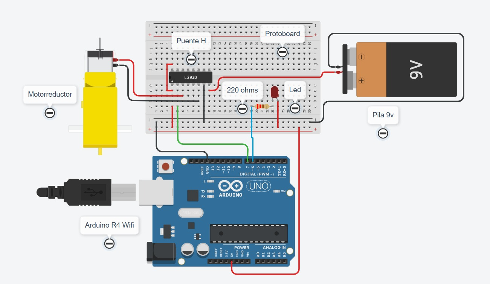
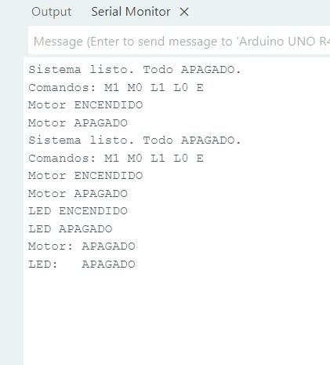
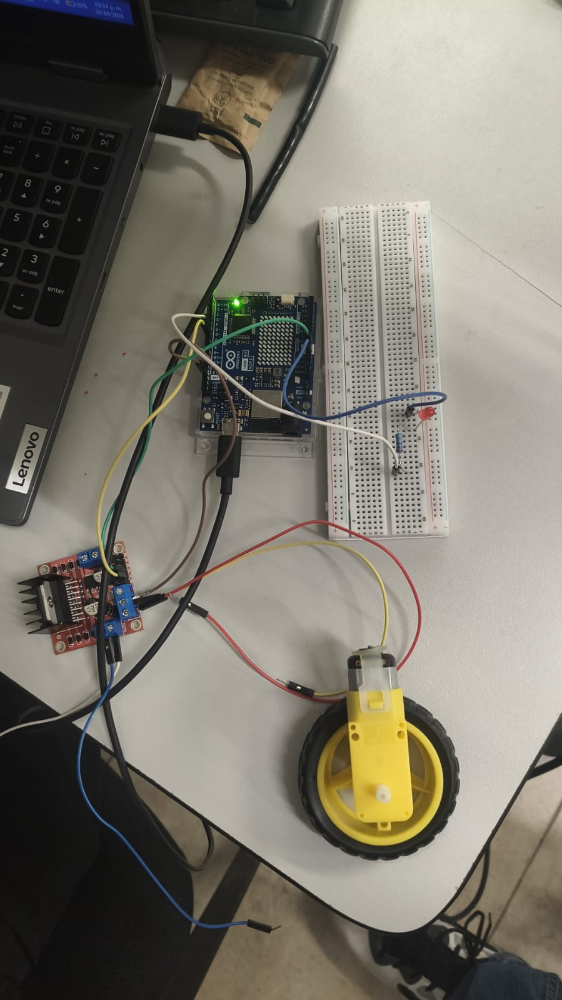
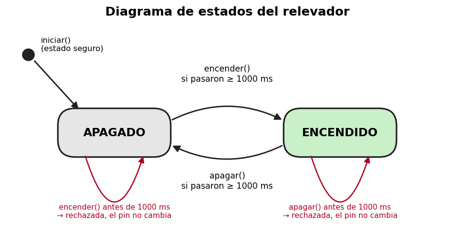

# Driver de software para un relevador

Arduino UNO R4 WiFi · Puente H L298N · Motorreductor · LED · Clase `Relevador` en C++

**Materia:** Sistemas Programables
**Profesor:** Miguel Barrón Hernández
**Integrantes:** Ximena Armenta Dávila, Carlos Tadeo Ibarra Castañeda y Dulce Princesa Ulivarría González

## Descripción

Se modela por software un relevador mediante una clase en C++ (`Relevador`) que guarda su estado, recibe órdenes (`encender()` y `apagar()`) y hace cumplir sus reglas de seguridad. La misma clase controla dos actuadores con lógica opuesta: un motorreductor a través de un canal del puente H L298N (**activo en ALTO**, pin D7) y un LED conectado "al revés" que imita al optoacoplador de un módulo de relevador real (**activo en BAJO**, pin D6).

La clase se encarga de:

- **Recordar el estado** del actuador (encendido o apagado).
- **Traducir la orden al nivel del pin**: decide si escribe HIGH o LOW según sea activo en alto o en bajo.
- **Respetar el tiempo mínimo entre cambios (1000 ms):** si una orden llega antes, se rechaza y el pin no cambia.
- **Garantizar un estado seguro:** al encender o reiniciar el sistema, todo queda apagado. Además, `iniciar()` escribe el nivel de apagado antes de configurar el pin como salida, para que el LED activo en bajo no dé un pulso al arrancar.

Los actuadores se controlan desde el Monitor serie (9600 baudios, con "Nueva línea"):

| Comando | Acción |
|---------|--------|
| M1 / M0 | Encender / apagar el motor |
| L1 / L0 | Encender / apagar el LED |
| E | Mostrar el estado de ambos |

## Objetivos de aprendizaje

- Abstraer el comportamiento de un dispositivo físico en un modelo de software con estados, órdenes y restricciones.
- Aplicar encapsulamiento en C++ para proteger el hardware de órdenes incorrectas.
- Distinguir la lógica "activo en alto" de la "activo en bajo" y resolverla dentro de la clase.
- Programar sin `delay()`, usando `millis()` para medir el tiempo mínimo entre cambios.
- Reconocer la necesidad de separar la parte de señal (Arduino) de la parte de potencia (portapilas del motor).

## Material utilizado

- Arduino UNO R4 WiFi y cable USB-C
- Módulo puente H L298N
- Motorreductor DC (tipo TT, 3–6 V)
- 2 pilas 18650 con portapilas en serie (≈ 7.4 V)
- LED
- Resistencia de 220 Ω
- Protoboard
- Cables jumper macho-macho y macho-hembra

Software: Arduino IDE 2, Monitor serie a 9600 baudios y Tinkercad para la simulación.

## Diagrama del circuito

<table>
  <tr>
    <td></td>
    <td></td>
  </tr>
  <tr>
    <td align="center" colspan="2"></td>
  </tr>
</table>

Arriba: circuito simulado en Tinkercad y captura del Monitor serie. Abajo: armado físico.

Diagrama de estados del relevador:



El estado inicial es APAGADO. Mientras no hayan pasado 1000 ms desde el último cambio, la orden se rechaza y el pin no cambia.

### Conexiones

**Parte de potencia (motor):**

| Origen | Destino |
|--------|---------|
| Positivo del portapilas | Terminal +12V del L298N |
| Negativo del portapilas | Terminal GND del L298N |
| GND del L298N | GND del Arduino (tierra común, obligatoria) |
| Motorreductor | OUT1 y OUT2 del L298N |

Se dejan puestos el jumper de ENA y el jumper 5V-EN.

**Parte de señal:**

| Señal | Arduino UNO R4 WiFi | Destino |
|-------|---------------------|---------|
| Orden del motor | D7 | IN1 del L298N |
| Sentido | — | IN2 del L298N a GND |
| LED activo en bajo (ánodo) | 5V | Ánodo del LED (pata larga) |
| LED activo en bajo (cátodo) | D6 | Cátodo del LED → resistencia de 220 Ω → D6 |

| Actuador | Pin | Lógica | Nivel de encendido |
|----------|-----|--------|--------------------|
| Motor (L298N) | D7 | Activo en ALTO | HIGH |
| LED al revés | D6 | Activo en BAJO | LOW |

> **Precauciones:** nunca alimentar el motor desde el pin 5V del Arduino, no conectar la terminal +5V del L298N al Arduino, revisar la polaridad del portapilas y armar todo con el USB desconectado.

## Código

- [Practica_4_1_1_A.ino](Codigo/Practica_4_1_1_A/Practica_4_1_1_A.ino): sketch completo con la clase `Relevador` y los dos objetos.

| Método | Qué hace |
|--------|----------|
| `iniciar()` | Escribe el nivel de apagado, configura el pin como salida y deja el actuador apagado |
| `encender()` | Enciende solo si ya pasó el tiempo mínimo. Regresa `true` si lo logró y `false` si no |
| `apagar()` | Apaga solo si ya pasó el tiempo mínimo. Regresa `true` si lo logró y `false` si no |
| `estaEncendido()` | Informa el estado actual |
| `faltaMs()` | Indica cuánto falta para poder conmutar otra vez |

```cpp
Relevador motor(7, false);   // L298N IN1 - activo en ALTO
Relevador led  (6, true);    // LED al revés - activo en BAJO
```

> **Nota:** el programa principal nunca usa `digitalWrite()` directamente y no usa `delay()`: todo pasa por la clase.

## Video del funcionamiento

- [Video](Video/Readme.txt)

## Resultados

En el Monitor serie se probaron los cinco comandos. Fragmento de la captura:

```
Sistema listo. Todo APAGADO.
Comandos: M1 M0 L1 L0 E
Motor ENCENDIDO
Motor APAGADO
Sistema listo. Todo APAGADO.
Comandos: M1 M0 L1 L0 E
Motor ENCENDIDO
Motor APAGADO
LED ENCENDIDO
LED APAGADO
Motor: APAGADO
LED:   APAGADO
```

- **Control por comandos:** M1/M0 encienden y apagan el motor, L1/L0 hacen lo mismo con el LED y E muestra el estado de ambos.
- **Prueba de seguridad 1 (M1 y M0 muy rápido):** la segunda orden llega antes de 1000 ms, por lo que la clase la rechaza con "Orden rechazada: espere X ms entre cambios" y el actuador no cambia.
- **Prueba de seguridad 2 (RESET con el motor encendido):** al reiniciar se ejecuta `iniciar()` y el motor y el LED quedan apagados. En la captura el mensaje de arranque aparece de nuevo después de haber encendido el motor.
- **Prueba de inversión:** si el LED se crea por error como "activo en alto", `encender()` escribiría HIGH y el LED se apagaría, y `apagar()` escribiría LOW y el LED se encendería. Desde el arranque quedaría prendido, aunque el monitor serie diga "APAGADO".

## Preguntas de reflexión

### 1. ¿Por qué el LED se enciende con LOW y no con HIGH? Explica el recorrido de la corriente.

El ánodo del LED está conectado a 5V y el cátodo va a D6 a través de la resistencia de 220 Ω. Cuando D6 está en LOW (0 V) hay diferencia de voltaje, y la corriente sale de 5V, pasa por el ánodo, el LED, el cátodo y la resistencia, y entra al pin D6, que la manda a tierra, por eso el LED se enciende. Cuando D6 está en HIGH (5 V), los dos lados tienen casi el mismo voltaje, no hay diferencia y no circula corriente, así que el LED se apaga.

### 2. ¿Qué ventaja tiene que la regla del tiempo mínimo viva dentro de la clase y no en el loop()?

Que la regla se cumple siempre, porque ninguna orden puede saltársela: todo pasa por `encender()` y `apagar()`. Además se escribe una sola vez y sirve para todos los objetos (motor y LED), y si se quiere cambiar el tiempo solo se modifica en la clase. El `loop()` queda sencillo y sin lógica de seguridad repetida.

### 3. ¿Por qué un relevador real no sirve para controlar velocidad con PWM?

Porque el PWM conmuta miles de veces por segundo y un relevador tiene contactos mecánicos que tardan en moverse y se desgastan con cada cambio. No alcanzaría a seguir la señal y se dañaría muy rápido. El relevador solo sirve para encender y apagar; para controlar velocidad se usa un transistor o un puente H con PWM.

### 4. ¿Por qué el estado seguro es "apagado"? Da un ejemplo industrial donde convenga lo contrario (contacto NC).

Porque si se va la luz o se reinicia el sistema, la carga no debe arrancar sola: un motor que se enciende de repente puede lastimar a alguien o dañar la máquina. Un ejemplo contrario es una bomba de enfriamiento o un freno de seguridad: con un contacto normalmente cerrado (NC), si falla la energía o el control, el contacto sigue cerrado y la bomba sigue funcionando para evitar un sobrecalentamiento.

### 5. ¿Por qué es obligatoria la tierra común entre el portapilas y el Arduino?

Porque el voltaje siempre se mide respecto a una referencia. La señal de D7 está referida al GND del Arduino y el L298N interpreta IN1 respecto a su propio GND. Si no están unidos, el L298N no tiene la misma referencia, no sabe si recibe HIGH o LOW y el motor funcionaría mal o no funcionaría.

### 6. Si mañana cambiaras el L298N por un módulo de relevador real, ¿qué partes del programa tendrías que modificar?

Casi nada. Solo la línea donde se crea el objeto (el pin y si es activo en alto o en bajo, porque muchos módulos de relevador son activo en bajo) y, si hace falta, el tiempo mínimo. La clase y el resto del programa siguen igual, porque la traducción HIGH/LOW está encapsulada dentro de la clase.

## Reporte

Reporte formal con introducción, capturas del circuito funcionando, metodología, análisis de resultados, preguntas de reflexión y conclusiones individuales.

[Reporte_Practica_4_1_1-A.pdf](Reporte/Reporte_Practica_4_1_1-A.pdf)

## Conclusiones

La práctica mostró que modelar un relevador como una clase permite que el resto del programa hable con órdenes que tienen significado (encender, apagar) sin preocuparse por el nivel del pin. Con un solo código se controlaron el motor (activo en alto) y el LED (activo en bajo), porque toda la traducción HIGH/LOW vive dentro de `_nivelPara()`. El tiempo mínimo de 1000 ms dentro de la clase protege al actuador de órdenes demasiado seguidas sin usar `delay()`, y el estado seguro de `iniciar()` hace que todo quede apagado al encender o reiniciar. También quedó claro que la señal (Arduino) debe separarse de la potencia (portapilas y L298N), unidas solo por la tierra común.
