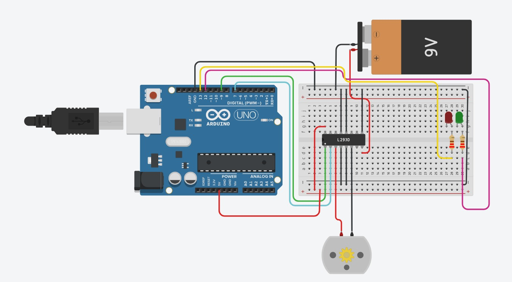
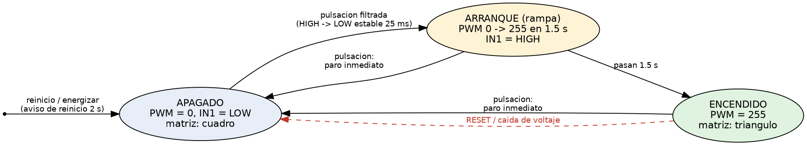

# Botón de arranque/paro a prueba de rebotes y apagones

Arduino UNO R4 WiFi · Puente H L298N · Motorreductor · Pulsador · Clase `Boton` en C++

**Materia:** Sistemas Programables
**Profesor:** Miguel Barrón Hernández
**Integrantes:** Ximena Armenta Dávila, Carlos Tadeo Ibarra Castañeda y Dulce Princesa Ulivarría González

## Descripción

Se controla un motorreductor con un solo botón: una pulsación lo arranca y la siguiente lo apaga. El sistema se defiende de dos fenómenos físicos reales:

1. **Rebote del botón:** la lámina metálica del pulsador rebota al chocar y el Arduino la lee como varias pulsaciones. Se resuelve con un filtro de rebotes dentro de la clase `Boton`, con una ventana de estabilidad de **25 ms** medida con `millis()` (sin `delay()`).
2. **Caída de voltaje (brownout):** el Arduino se reinicia y no debe hacer nada que nadie ordenó. Al arrancar, `setup()` deja el motor apagado, muestra un aviso de reinicio y el motor solo arranca con una nueva pulsación, con una rampa de PWM de 0 a 255 en 1.5 s.

La matriz LED del UNO R4 WiFi muestra el aviso de reinicio (signo !) y después el estado del motor (triángulo = encendido, cuadro = apagado).

## Objetivos de aprendizaje

- Identificar fenómenos físicos que alteran el comportamiento de un sistema programable.
- Implementar un filtro de rebotes no bloqueante con `millis()`.
- Detectar flancos de una señal digital (paso de suelto a oprimido).
- Diseñar un arranque seguro: el sistema nunca hace algo que nadie ordenó después de un reinicio.
- Aplicar una rampa de arranque con PWM para reducir el pico de corriente del motor.

## Material utilizado

- Arduino UNO R4 WiFi y cable USB-C
- Módulo puente H L298N
- Motorreductor DC (tipo TT, 3–6 V)
- 2 pilas 18650 con portapilas en serie (≈ 7.4 V)
- Pulsador
- Protoboard
- Cables jumper macho-macho y macho-hembra

Software: Arduino IDE 2, Monitor serie a 9600 baudios y Tinkercad para la simulación.

## Diagrama del circuito

<table>
  <tr>
    <td></td>
    <td></td>
  </tr>
  <tr>
    <td></td>
    <td></td>
  </tr>
</table>

Circuito simulado en Tinkercad y captura del Monitor serie.

Diagrama de estados del sistema:

El estado inicial siempre es APAGADO. La pulsación filtrada inicia la rampa de arranque, al terminar queda ENCENDIDO y otra pulsación lo apaga de inmediato. Un RESET o una caída de voltaje regresa siempre a APAGADO.

### Conexiones

**Parte de potencia (motor):**

| Origen | Destino |
|--------|---------|
| Positivo del portapilas | Terminal +12V del L298N |
| Negativo del portapilas | Terminal GND del L298N |
| GND del L298N | GND del Arduino (tierra común, obligatoria) |
| Motorreductor | OUT1 y OUT2 del L298N |

Se deja puesto el jumper 5V-EN y se quita el jumper de ENA para controlar la velocidad con PWM.

**Parte de señal:**

| Señal | Arduino UNO R4 WiFi | Destino |
|-------|---------------------|---------|
| Velocidad (PWM, rampa) | D9 | ENA del L298N |
| Encendido | D7 | IN1 del L298N |
| Sentido | — | IN2 del L298N a GND |
| Botón | D2 | Una pata del pulsador (la otra pata a GND) |

El botón no lleva resistencia externa: se usa la resistencia interna con `INPUT_PULLUP` (suelto = HIGH, oprimido = LOW).

**Simulación en Tinkercad (puente H L293D):**

| Pin del L293D | Conexión |
|---------------|----------|
| 1 (EN1) | D9 |
| 2 (IN1) | D7 |
| 3 (OUT1) y 6 (OUT2) | Terminales del motor |
| 7 (IN2) | GND |
| 4, 5 (GND) | GND común (Arduino y batería) |
| 8 (VS) | + de la pila de 9 V |
| 16 (VCC1) | 5V del Arduino |

El pulsador va de D2 a GND.

> **Precauciones:** nunca alimentar el motor desde el pin 5V del Arduino, no conectar la terminal +5V del L298N al Arduino, revisar la polaridad del portapilas y armar todo con el USB desconectado.

## Código

- [Practica_4_1_2.ino](Codigo/Practica_4_1_2/Practica_4_1_2.ino): versión final para el UNO R4 WiFi con clase `Boton`, rampa, aviso de reinicio y matriz LED.
- [Practica_4_1_2_Tinkercad.ino](Codigo/Practica_4_1_2_Tinkercad/Practica_4_1_2_Tinkercad.ino): misma lógica para simular en Tinkercad (el LED D13 hace de matriz).
- [Practica_4_1_2_SinFiltro.ino](Codigo/Practica_4_1_2_SinFiltro/Practica_4_1_2_SinFiltro.ino): versión sin filtro para la prueba de rebote (paso 2).

> **Nota:** el programa no usa `delay()`. La rampa también se mide con `millis()`: el PWM sube de 0 a 255 en 1.5 s, en pasos de 10 ms.

## Video del funcionamiento

- [Video](Video/Readme.txt)
- [Ver video en YouTube](https://youtu.be/lTGnAIjWwAw)

## Resultados

Tabla de resultados (llenar con las pruebas realizadas):

| Prueba | Pulsaciones reales | Pulsaciones contadas | Veces que el motor no obedeció |
|--------|--------------------|----------------------|--------------------------------|
| Sin filtro, intento 1 | 10 | | |
| Sin filtro, intento 2 | 10 | | |
| Sin filtro, intento 3 | 10 | | |
| Ventana 2 ms | 10 | | |
| Ventana 25 ms | 10 | | |
| Ventana 300 ms | 10 | | |

Comparación del arranque (PWM directo a 255 contra rampa): _describir lo observado._

## Reporte

Reporte formal con introducción, capturas del circuito funcionando, metodología, análisis de resultados, preguntas de reflexión y conclusiones individuales.

[Reporte_Practica_4_1_2.pdf](Reporte/Reporte_Practica_4_1_2.pdf)

## Conclusiones

La práctica mostró que el mundo físico no es ideal: el botón rebota y la alimentación puede caer. Con la clase `Boton` y su ventana de 25 ms medida con `millis()`, cada pulsación real se entrega una sola vez y sin detener el programa. Con el estado seguro en `setup()`, el aviso de reinicio y la rampa de PWM, el sistema nunca arranca el motor por sí solo después de un reinicio y reduce el pico de corriente que provoca las caídas de voltaje. También quedó claro que el software ayuda pero no arregla todo: la potencia debe ir en una fuente separada, con tierra común.
